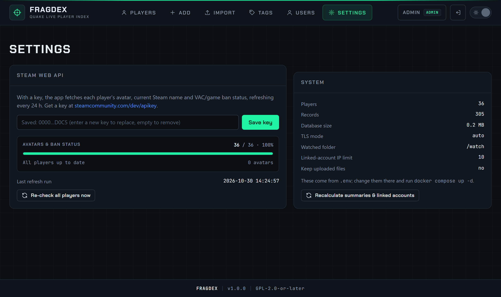

# Steam Web API

With a free Steam Web API key, Fragdex adds to every player:

- the Steam **avatar**,
- the **current Steam name**, shown under the latest in-game name when they differ, and searchable,
- **VAC bans, game bans and community bans**, with the days since the last ban, as a **VAC** or **BAN** badge,
- the Steam **profile visibility** (public, private, not found).

It also enables the **ban status** filter on the Players page.

## Get and set a key

1. Log in to Steam and open <https://steamcommunity.com/dev/apikey>.
2. Enter any domain name (for example your Fragdex address), accept the terms and copy the 32-character key.
3. In Fragdex, open **Settings → Steam Web API**, paste the key and press **Save key**.

The refresh starts straight away. To remove the key, save an empty field.

You can set the key in `.env` instead (`STEAM_API_KEY=…`, then `docker compose up -d`). A key set in `.env` takes priority and cannot be changed from the web page.

!!! warning "Keep the key private"
    The key is tied to your Steam account. Fragdex shows only its last characters and never includes it in error messages.

## Background refresh

A background job checks players in batches of 100, players never checked first, then the ones checked longest ago. It re-checks each player every `STEAM_REFRESH_HOURS` hours (24 by default). New players from an import are picked up within moments.

**Settings → Steam Web API** shows the progress live: players checked out of the total, avatars found, the estimated time left, when the last run finished and the last error, if any.

{ .shot loading=lazy }

- **Re-check all players now** marks every player for a refresh, for example after a wave of bans.
- **Refresh Steam** on a [player profile](../guide/player-profile.md) updates one player immediately.

Steam limits the Web API to about 100,000 calls per day per key. Each call covers up to 100 players, so even very large databases stay far below it.

## Privacy

Fragdex sends Steam only Steam IDs, nothing else. Avatars are loaded by the viewer's browser straight from Steam's image servers.
