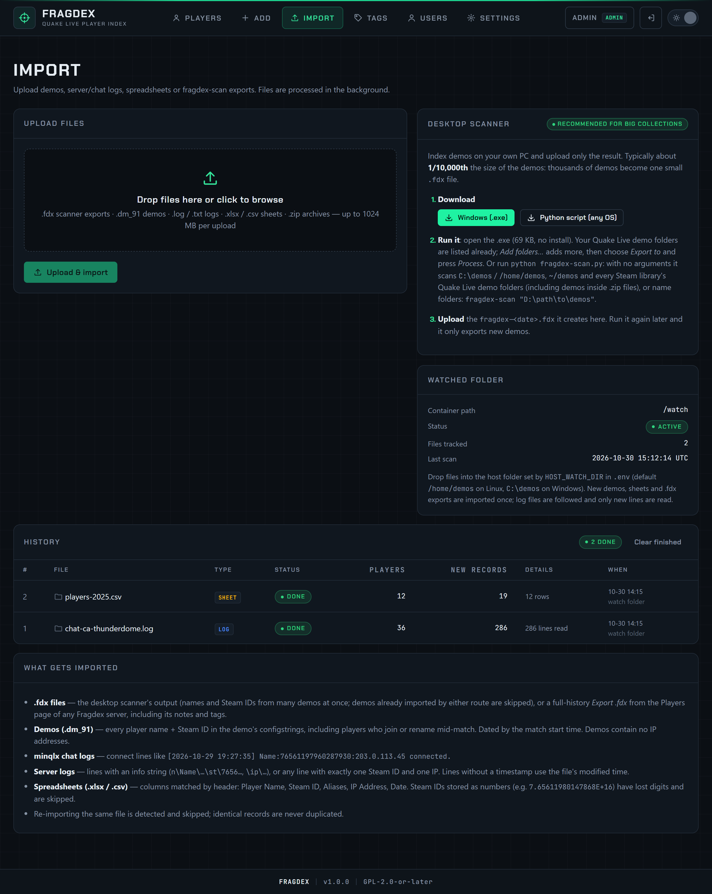

# First login and import

## 1. Log in and change the password

Open the address the installer printed and log in with the admin username and password. Then:

1. Go to **Account** and change the password (at least 10 characters).
2. Remove the `ADMIN_PASSWORD=` value from `.env`. It is only used to create the first admin account, on the very first start, but there is no reason to keep it lying around.

## 2. Add users

Under **Users** (admins only), create an account for each person who needs access and give them the lowest role that works for them:

| Role | Can |
|---|---|
| **Viewer** | Search, view and export. |
| **Editor** | Everything a viewer can, plus import files, add and delete records, edit notes and tags. |
| **Admin** | Everything, plus manage users and settings and delete players. |

See [Users and roles](../administration/users.md).

## 3. Import your data

Pick whichever fits what you have:

| You have | Do this |
|---|---|
| A few demos, logs or a spreadsheet | **Import → Upload files**. Several files or `.zip` archives at once. |
| Thousands of demos on your PC | Download **fragdex-scan** from **Import → Desktop scanner**, scan locally, upload the small `.fdx` file. See [fragdex-scan](../importing/fragdex-scan.md). |
| Demos or logs on the Fragdex server itself | Put them in the watched folder (`/home/demos` or `C:\demos` by default). New files are picked up every minute. |
| A live Quake Live server on the same machine | Point `HOST_WATCH_DIR` at its demo or log folder. Logs are followed: only new lines are read each time. |

Imports run in the background; the **History** table on the Import page shows each file's progress and results.

{ .shot loading=lazy }

## 4. Optional: add a Steam Web API key

With a key, Fragdex adds avatars, current Steam names and VAC/game ban status for every player. Get one at <https://steamcommunity.com/dev/apikey> and paste it under **Settings → Steam Web API**. See [Steam Web API](../administration/steam.md).

## 5. Start searching

Go to **Players** and type a name, Steam ID or IP. See [Search and filter players](../guide/search.md).
