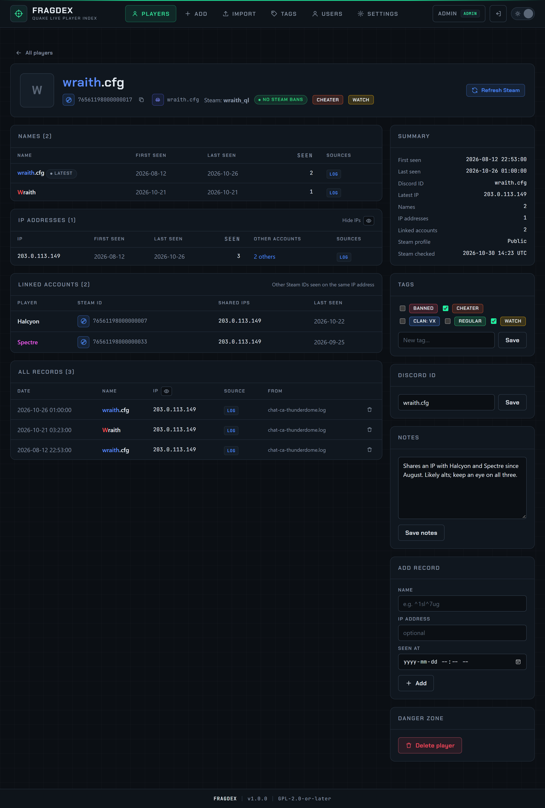

# Player profile

Click a player's name anywhere in Fragdex to open their profile. The page shows everything known about one Steam ID.

{ .shot loading=lazy }

## Header

The latest name in its Quake colours, the avatar and current Steam name (with a Steam key), the SteamID64 with a **copy** button and a link to the Steam profile. Editors also see **Refresh Steam**, which fetches the Steam details for this player immediately instead of waiting for the next background refresh.

## Names

Every name the player has used, with the first and last date it was seen, how many times, and which sources it came from. Names are shown in their Quake colours; different colourings of the same name are listed separately.

## IP addresses

Every IP address with first and last seen dates, how often it was seen, its sources and **Other accounts**: how many other Steam IDs were seen on the same IP. Click the count to search for everyone on that IP.

An IP shared by more accounts than the linked-account limit (10 by default) is greyed out: it is most likely a VPN, a LAN centre or carrier-grade NAT, and it is ignored for linking. See [Linked accounts](linked-accounts.md).

The **Hide IPs** toggle masks the addresses on screen, as on the Players page.

## Linked accounts

Other Steam IDs seen on the same IP address as this player, with how many IPs they share and when they were last seen. See [Linked accounts](linked-accounts.md).

## All records

The raw records behind everything above: date, name, IP, source and the file and server each one came from. The latest records are shown; the heading gives the total.

Editors can delete a single record with the bin icon, for example a wrong entry from a spreadsheet. The player's summary, names, IPs and linked accounts are recalculated straight away.

## Summary

First and last seen, Discord ID, latest IP, number of names, IPs and linked accounts, and, with a Steam key: profile visibility (public, private or not found), VAC and game bans, days since the last ban, and when Steam was last checked.

## Discord ID

One Discord account per player, shown in the header (with a link to the Discord profile for numeric IDs), in the Summary and in the **Discord ID** column of the Players page. Editors can set, change or clear it in the **Discord ID** panel: leave the field empty and press **Save** to remove it.

Accepted values:

| Format | Example |
|---|---|
| Discord user ID (17–20 digits) | `80351110224678912` |
| Mention | `<@80351110224678912>` |
| Profile link | `https://discord.com/users/80351110224678912` |
| Username | `frostbite`, `@frost.bite` (stored in lower case) |
| Legacy username with tag | `Frostbite#1234` |

Prefer the numeric user ID: it never changes, while usernames can. In Discord, enable **Settings → Advanced → Developer Mode**, then right-click a user and choose **Copy User ID**.

Discord IDs can also come from the **Add** page, a spreadsheet with a *Discord ID* column, or a `.fdx` export from another Fragdex server. Imports only fill in an empty Discord ID; they never overwrite one that is already set.

## Tags and notes

Tick tags to apply them, or type a **New tag** name to create one and apply it in one go. **Notes** are free text: bans, reports, evidence links, context. Both need the editor role. See [Tags and notes](tags-and-notes.md).

## Add record

Editors can add a name and/or IP with a date to this player by hand. See [Add records manually](add-records.md).

## Danger zone

Admins can **Delete player**: the player, all their records, notes and tags are removed, and linked accounts are recalculated. This cannot be undone, so consider [exporting](export.md) the player as `.fdx` first.

Files that were already imported are not imported again, so a deleted player does not come back from those. They reappear only if a new file contains them.
