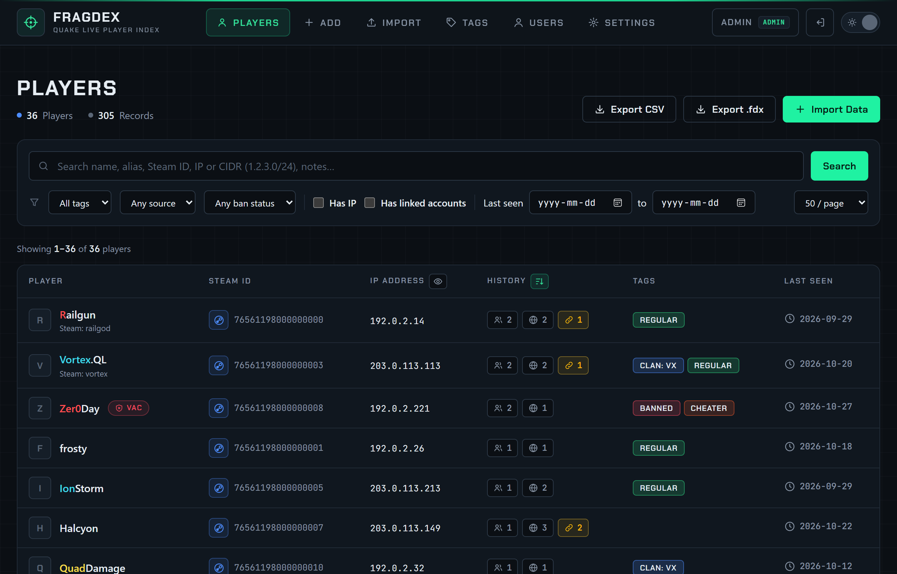

# Search and filter players

The **Players** page is the home page. The counters at the top show how many players and records the database holds, and how many imports are running.

{ .shot loading=lazy }

## Search

Type in the search box and press ++enter++ or **Search**. One box covers everything:

| You type | Finds players |
|---|---|
| A name, such as `rail` | who used a name containing it, at any time. Case and Quake colour codes are ignored, so `railgun` finds Railgun. Also matches the current Steam name. |
| A Steam ID, such as `76561198` | whose SteamID64 starts with it. |
| An IP address, such as `203.0.113.45` | seen on that IP. A partial address such as `203.0.113.` matches the whole range by prefix. |
| A CIDR range, such as `203.0.113.0/24` or `2001:db8::/32` | seen on any IP inside the range (IPv4 or IPv6). |
| Any word from a note, such as `aimbot` | whose notes contain it. |

**Clear** removes the search and every filter.

## Filters

The row under the search box narrows the list further. Drop-downs and check boxes apply immediately.

| Filter | Shows |
|---|---|
| **All tags** | players with the chosen tag. See [Tags and notes](tags-and-notes.md). |
| **Any source** | players with at least one record from demos, logs, XLSX, CSV or manual entry. |
| **Any ban status** | *VAC banned*, *Any Steam ban* (VAC, game or community ban) or *No bans*. Only shown once a [Steam Web API key](../administration/steam.md) is set. |
| **Has IP** | players with at least one known IP address. Demos contain no IPs, so this hides demo-only players. |
| **Has linked accounts** | players who share an IP with another Steam ID. See [Linked accounts](linked-accounts.md). |
| **Last seen** from / to | players last seen within the date range. |
| **50 / page** | 25, 50, 100 or 250 players per page. |

Filters combine with the search: `203.0.113.0/24` plus *Has linked accounts* plus a date range is a perfectly good query.

## The player list

| Column | Shows |
|---|---|
| **Player** | Avatar (with a Steam key), the latest name in its Quake colours, the current Steam name when it differs, and a **VAC** or **BAN** badge for banned accounts. Click the name to open the [player profile](player-profile.md). |
| **Steam ID** | The SteamID64. The Steam icon opens the Steam profile in a new tab. |
| **IP Address** | The latest known IP. |
| **History** | Small icons with counts. **Names**: other names the player used; **IPs**: every IP address they were seen on. Click either to see the list with dates. A highlighted **link** icon appears when the player has [linked accounts](linked-accounts.md); click it to jump to them. |
| **Tags** | The player's tags. |
| **Last seen** | Date of the most recent record. |

### Sorting

Click a column heading to sort by it; click again to reverse. The list is sorted by **Last seen**, newest first, by default.

The icon in the **History** heading sorts by **most aliases**, so the players who change names most come first. Click it again to go back to newest first.

### Hide IPs

The eye icon in the **IP Address** heading hides every IP address on the page, for screen-sharing or streaming. It is remembered per browser and only changes what is displayed: the data and exports are unaffected. The player profile has the same toggle.

## Exporting a search

**Export CSV** and **Export .fdx** at the top of the page export the players in the current search and filters, or everyone when nothing is filtered. See [Export CSV and .fdx](export.md).

## Search tips

- **Find someone's other accounts:** open their profile and look at **Linked accounts**, or search their IP and tick *Has linked accounts*.
- **Who played from a provider or region:** search the provider's range, such as `198.51.100.0/22`.
- **Recently active banned players:** *Any Steam ban* plus a *Last seen* date range.
- **Every record from one server:** open a player and use the **All records** table, which shows the source file and server of each record.
