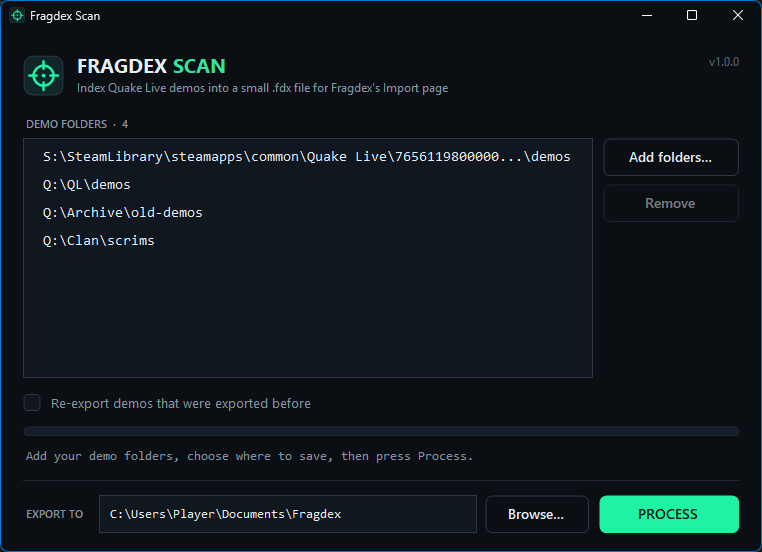

# fragdex-scan desktop tool

Uploading gigabytes of demos to a server is slow. **fragdex-scan** does the heavy lifting on your own PC instead: it reads every demo, keeps only what Fragdex needs (names, Steam IDs, map, server, date and a fingerprint of each file) and writes it to one small `.fdx` file that you upload instead.

| Real collection | Size |
|---|---|
| 1,916 demos, including a `.zip` | 8.3 GB |
| The `.fdx` file fragdex-scan made of them | **~500 KB** |
| Time to scan (Windows app) | 7 seconds |
| Time for the server to import it | about 2 seconds |

Download it from **Import → Desktop scanner** on your Fragdex server. There are two versions; they produce identical results and share their memory of what was already exported.

## Windows app

`fragdex-scan.exe` is a 70 KB program with a window. It needs no installation and runs on any Windows 10 or 11 PC (it uses the .NET Framework 4.6.2+ built into Windows).

{ .shot loading=lazy width=560 }

1. **Start it.** The folder list already contains the Quake Live demo folders of every Steam library on the PC.
2. **Add folders…** to add more, several at once, or drag folders from Explorer onto the list. **Remove** takes the selected ones off.
3. Choose where the `.fdx` file goes under **Export to** (default `Documents\Fragdex`). Tick **Re-export demos that were exported before** only if you want a complete export again (see [below](#only-new-demos-every-time)).
4. Press **Process.** A progress bar shows the scan; the button turns into **Cancel** while it runs.
5. When it finishes, **Open folder** shows the new `fragdex-<date>-<time>.fdx` file. Upload it on the Import page, or copy it into the server's [watched folder](overview.md#watched-folder).

Your folder list and export folder are remembered for next time (in `%APPDATA%\Fragdex\fragdex-scan.txt`).

!!! tip "Windows SmartScreen"
    Because the program is not code-signed, Windows may show *Windows protected your PC* the first time. Click **More info → Run anyway**. The source is in the repository (`app/scanner-win/`), and you can [build it yourself](../project/development.md) with the compiler that ships with Windows.

### Command line

The same program works from a script or scheduled task:

```powershell
fragdex-scan.exe --out D:\exports\demos.fdx "D:\QL\demos" "E:\old-demos.zip"
fragdex-scan.exe --out D:\exports\all.fdx --all "D:\QL\demos"   # include demos exported before
fragdex-scan.exe --version
```

## Python script

`fragdex-scan.py` runs anywhere Python 3.8 or newer does (Linux, macOS, Windows) and needs no extra packages.

```bash
python fragdex-scan.py                          # default folders (see below)
python fragdex-scan.py "D:\QL\demos" old.zip    # specific folders, demos or .zip archives
python fragdex-scan.py --logs D:\logs           # also index server and minqlx chat logs
python fragdex-scan.py -o my.fdx --all ~/demos  # chosen output file, include everything
```

| Option | |
|---|---|
| `folders` | Folders, demo files or `.zip` archives to scan. |
| `-o`, `--output` | Output file. Default: `fragdex-<date>-<time>.fdx` in the current folder. |
| `--all` | Include files that an earlier run already exported. |
| `--logs` | Also index `.log` and `.txt` server and chat logs. |
| `-j`, `--jobs` | Parallel workers. Default: one per CPU core. |

With no folders given it scans `C:\demos` or `/home/demos`, `~/demos`, and the Quake Live demo folders of every Steam library it finds.

## What gets scanned

- **Folders are scanned recursively**: every subfolder, at any depth.
- **`.zip` archives** found along the way are opened and the demos inside them scanned.
- **Folder shortcuts are not followed.** Junctions and symbolic links inside a folder are skipped, so a link that points back up the tree cannot make the scan loop. A folder you add yourself is always scanned, even if it is a link.
- **Overlapping folders are fine.** Add `D:\Games` and `D:\Games\QL\demos` and each demo is still scanned once.
- Unreadable folders are skipped instead of stopping the scan.

## Only new demos, every time

fragdex-scan remembers what it has exported in `fragdex-scan-state.json`, next to the output file. The next run only exports demos that are new or changed, so the second `.fdx` from the same folders is tiny. Both versions read and write the same file, so you can switch between them.

Tick **Re-export demos that were exported before** in the Windows app, or use `--all`, to export everything again. That is harmless: the server recognises demos it already has, whichever way they arrived, and skips them.

## Privacy

The `.fdx` file contains the names and Steam IDs of the players in your demos, the map and server names, file names, sizes and SHA-256 fingerprints. It contains nothing else from your PC. Demos contain no IP addresses, so neither does a demo-only `.fdx`.
