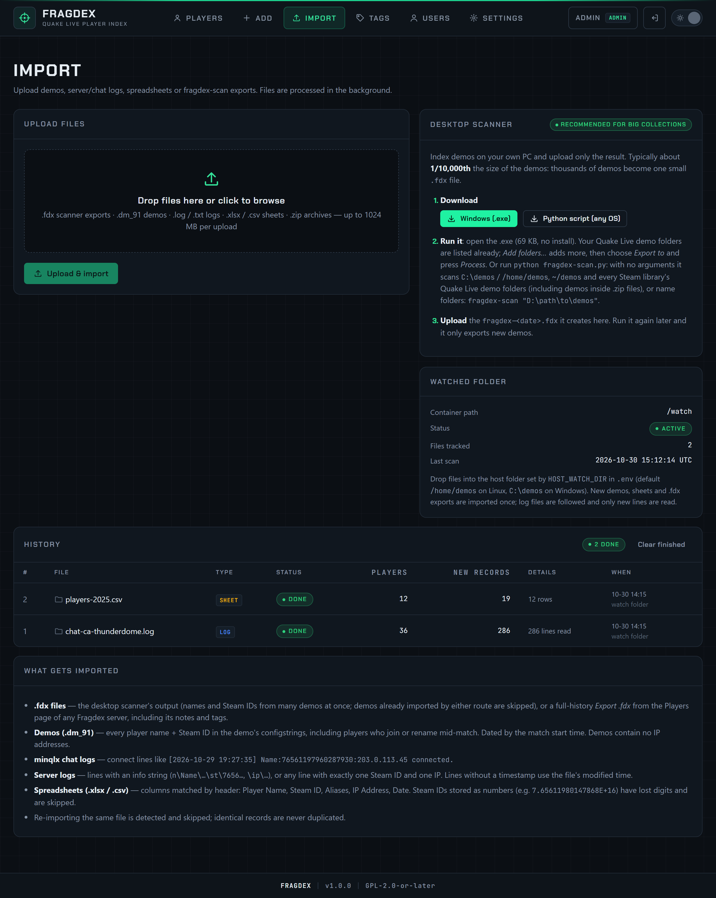

# Import page and watched folder

There are two ways to get files into Fragdex: upload them on the **Import** page, or drop them into the **watched folder** on the server. Both feed the same background import queue. Importing needs the **editor** role.

{ .shot loading=lazy }

## Upload files

On **Import → Upload files**, choose or drag in any number of files, then press **Upload & import**.

Accepted files:

| Type | Extensions |
|---|---|
| Demos | `.dm_91` (any `.dm_<number>`) |
| Server and chat logs | `.log`, `.txt` |
| Spreadsheets | `.xlsx`, `.xlsm`, `.csv` |
| fragdex-scan and Fragdex exports | `.fdx` |
| Archives | `.zip` containing any of the above, in any folder structure |

The maximum size of one upload is `MAX_UPLOAD_MB` (1024 MB by default). For big demo collections, [fragdex-scan](fragdex-scan.md) is far faster: it uploads a file about 1/10,000th the size of the demos.

## Watched folder

Fragdex checks a folder on the host every `WATCH_INTERVAL` seconds (60 by default) and imports new or changed files, including files in subfolders and inside `.zip` archives.

| | Default |
|---|---|
| Linux host | `/home/demos` |
| Windows host | `C:\demos` |

Set it with `HOST_WATCH_DIR` in `.env`. It is mounted **read-only**: Fragdex never changes or deletes anything in it.

Useful setups:

- **Point it at a Quake Live server's `baseq3/demos` folder** to index every demo the server records.
- **Point it at a live log folder.** Log files are *followed*: each scan reads only the lines added since the last one, so a growing minqlx chat log is imported continuously.
- **Use it as a drop box** for `.fdx` files from fragdex-scan, copied over with `scp`, SFTP or a shared folder.

The **Watched folder** panel on the Import page shows the path inside the container, whether it is mounted, how many files are tracked and when it was last scanned.

!!! note "Docker Desktop on Windows"
    With the WSL 2 backend, `C:\demos` is shared with the container automatically. With the Hyper-V backend, add the folder under **Docker Desktop → Settings → Resources → File sharing**.

## Import history

The **History** table lists every import: file, type, status, how many players it touched, how many new records it added, details (such as how many rows were skipped and why) and when. Files from the watched folder have a folder icon; uploads have a file icon.

- **Retry** re-runs an import that failed, for example after a disk-full error.
- **Clear finished** removes completed entries from the list. The imported data stays.

## Duplicates

You can import freely without worrying about duplicates:

- **The same file is never imported twice.** Files are recognised by their SHA-256 hash, whichever way they arrive: a demo uploaded directly, found in the watched folder, inside a `.zip` or listed in a `.fdx` is imported once.
- **Identical records are never stored twice.** A record is the combination of Steam ID, name, IP, date and source.

So re-uploading an archive that contains some new and some old demos only imports the new ones.

## After an import

Each import updates the player summaries (latest name, latest IP, counts) and recalculates [linked accounts](../guide/linked-accounts.md). With a [Steam key](../administration/steam.md), new players are queued for the Steam refresh.
