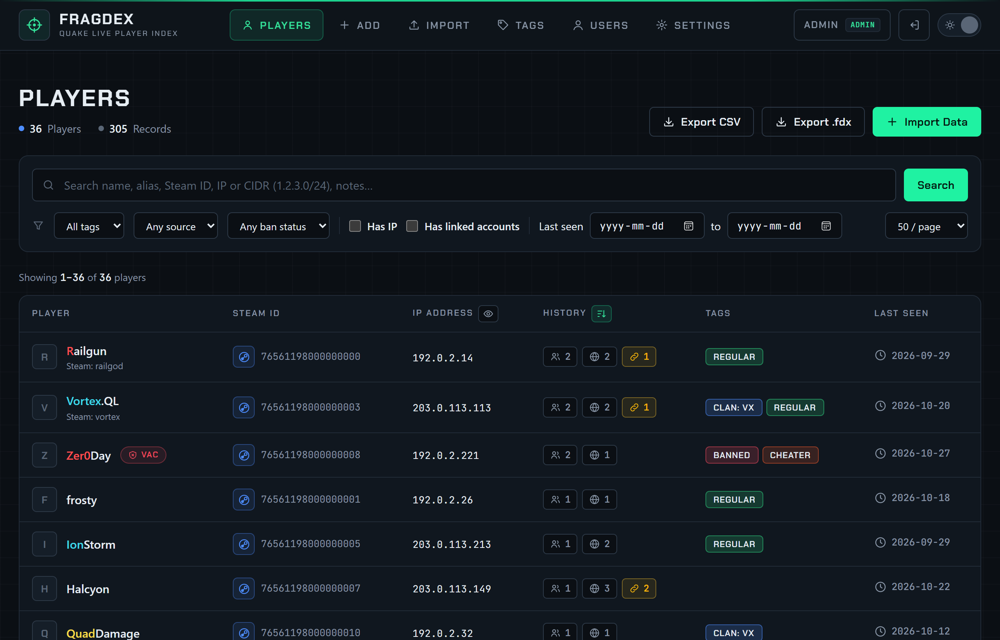

---
hide:
  - navigation
---

# Fragdex: Quake Live player database

**Fragdex is a self-hosted, login-protected player database built for Quake Live server administrators.** It consolidates player information from demos, server logs, chat logs, and spreadsheets into a centralized, searchable database. Search by name, alias, Steam ID, IP address, or CIDR range to investigate player histories, track past names and IPs, identify potential alternate accounts sharing an IP, and organize records with notes, tags, and ban status. Optional Steam Web API integration adds profile avatars, current Steam names, and VAC or game-ban information, while advanced filtering and CSV exports make player research and moderation easier.

{ .shot loading=lazy }

Designed for flexibility and portability, Fragdex includes the `fragdex-scan` desktop tool for indexing large demo collections locally and uploading compact `.fdx` files instead of entire archives. The `.fdx` format preserves complete player histories, notes, and tags for backups and transfers between servers. Role-based permissions separate viewer, editor, and administrator access, while Docker deployment with automatic HTTPS simplifies self-hosting. **Fragdex gives server operators a single, reliable source of player intelligence**, reducing manual investigation time, helping identify linked accounts, and keeping player data under their control.

[Install Fragdex](getting-started/installation.md){ .md-button .md-button--primary }
[What is Fragdex?](getting-started/introduction.md){ .md-button }

## Start here

<div class="grid cards" markdown>

-   :material-download-box-outline: **[Installation](getting-started/installation.md)**

    ---

    One interactive installer for Linux or Windows: Docker, automatic HTTPS, an admin login in minutes.

-   :material-database-import-outline: **[First login and import](getting-started/first-steps.md)**

    ---

    Change the admin password, add users and load your first demos, logs or spreadsheets.

-   :material-account-search-outline: **[Search and filter players](guide/search.md)**

    ---

    Names, aliases, Steam IDs, IPs and CIDR ranges, with filters for tags, sources, bans and dates.

-   :material-folder-zip-outline: **[fragdex-scan](importing/fragdex-scan.md)**

    ---

    Index thousands of demos on your own PC and upload one small `.fdx` file instead.

</div>

## Core topics

- **Using Fragdex**: [Search and filter](guide/search.md), [Player profile](guide/player-profile.md), [Linked accounts](guide/linked-accounts.md), [Tags and notes](guide/tags-and-notes.md), [Add records manually](guide/add-records.md), [Export CSV and .fdx](guide/export.md).
- **Importing data**: [Import page and watched folder](importing/overview.md), [Supported sources](importing/sources.md), [fragdex-scan desktop tool](importing/fragdex-scan.md), [The .fdx format](importing/fdx-format.md).
- **Administration**: [Users and roles](administration/users.md), [Steam Web API](administration/steam.md), [Settings and .env reference](administration/settings.md), [HTTPS and ports](administration/https.md), [Updating](administration/updating.md), [Backup and restore](administration/backup-restore.md), [Security](administration/security.md).

## Install

**Linux** server with Docker and the Compose plugin:

```bash
git clone https://github.com/D00MSDAYDEVICE/fragdex.git && cd fragdex
./deployfragdex.sh
```

**Windows** host with Docker Desktop running:

```powershell
git clone https://github.com/D00MSDAYDEVICE/fragdex.git; cd fragdex
powershell -ExecutionPolicy Bypass -File .\deployfragdex.ps1
```

See [Installation](getting-started/installation.md) for requirements and every option.

## Links

- Repository: <https://github.com/D00MSDAYDEVICE/fragdex>
- Issues and feature requests: <https://github.com/D00MSDAYDEVICE/fragdex/issues>
